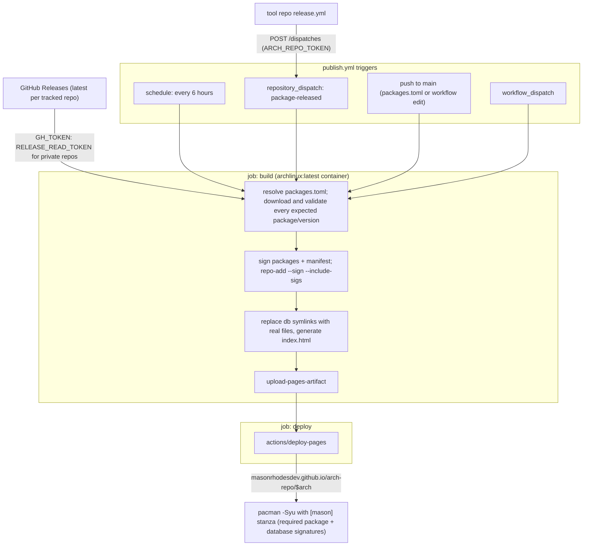

# arch-repo

Self-hosted pacman repository for MasonRhodesDev packages, served from GitHub
Pages. The publish workflow resolves every release in
[`packages.toml`](packages.toml), requires the exact declared package set and
release version, signs the packages and repository database, and deploys the
result atomically.

## Use it

Import and locally trust the dedicated repository key:

```bash
curl -fsSLo /tmp/mason-repo.asc \
  https://masonrhodesdev.github.io/arch-repo/mason-repo.asc
test "$(gpg --show-keys --with-colons /tmp/mason-repo.asc |
  awk -F: '$1 == "fpr" { print $10; exit }')" = \
  "41450EEF8CEE7AB8CD3896221284404A6B70485C"
sudo pacman-key --add /tmp/mason-repo.asc
sudo pacman-key --lsign-key 41450EEF8CEE7AB8CD3896221284404A6B70485C
rm /tmp/mason-repo.asc
```

Then add to `/etc/pacman.conf`:

```ini
[mason]
SigLevel = Required DatabaseRequired
Server = https://masonrhodesdev.github.io/arch-repo/$arch
```

`$arch` is substituted by pacman from its `Architecture` setting, so the same
stanza works on x86_64 and aarch64. The repository serves one directory per
architecture: `x86_64` holds the x86_64 builds, `aarch64` holds the aarch64
builds, and `arch=any` packages appear in both. An architecture with no
packages at all gets no directory, so pointing a client at it fails loudly
rather than silently serving nothing.

Then `sudo pacman -Syu` and install packages normally (`sudo pacman -S
hyprstate sni-watcher ...`).

### Steam Deck (user-level pacman root)

The same repo works with deck-tenant's rootless pacman root — add the same
`[mason]` section to the pacman.conf used with
`pacman --root ~/.local/share/deck-pkgs` and update from there. No more
building in distrobox on the Deck.

## Hyprland -git stack

`pkgbuilds/` holds the Hyprland -git stack: hyprland-git, the hypr* libraries
and tools it is used with, xdg-desktop-portal-hyprland-git, gamemode-git and
matugen-bin. Each PKGBUILD pins an upstream commit in `_commit`; bump a pin by
editing it in a pull request, which builds the whole stack before merge.

`git-builds.yml` builds every package in dependency order in one job.
`scripts/stack_plan.py` derives the order from the PKGBUILDs, and
`scripts/build_stack.sh` installs only a package's declared stack
dependencies before building it. On main the result is published as one
`v<N>` release in which every package has pkgrel N, so each rebuild upgrades
the whole stack together. `packages.toml` tracks that release with
`versioning = "pkgrel"`, and older stack releases are pruned to the newest 3.

`soname-check.yml` runs every 6 hours. `scripts/soname_drift.py` reads the
NEEDED entries of the published packages and looks each library up in the
current Arch files database. When one is gone (for example after a libjxl
soname bump) it starts `git-builds.yml`, which rebuilds the stack at the same
pins against the new library. The build runs the same check on its own output
and does not publish while anything is still missing.

Build it locally as root in an Arch container with `base-devel`, `git` and
`python` installed and an unprivileged user that has passwordless sudo:
`bash scripts/build_stack.sh <user> <pkgrel> <empty-output-dir>`.

## Refresh cadence

- Every 6 hours on schedule
- Immediately when a project release sends `repository_dispatch`
  (`package-released`) — requires the `ARCH_REPO_TOKEN` secret in the
  project repo
- Manually: `gh workflow run publish.yml -R MasonRhodesDev/arch-repo`



## Adding a package

Add a `[[release]]` entry to `packages.toml`, including every expected package
name. Publication fails instead of serving a partial, stale, unexpected, or
unsigned package set.

The signing fingerprint is committed in `signing-fingerprint.txt`. The
private CI-only key is stored only as the `PACKAGE_SIGNING_KEY` Actions secret
and expires in August 2028; rotate it before expiry and publish a migration
notice before changing the trusted fingerprint.
